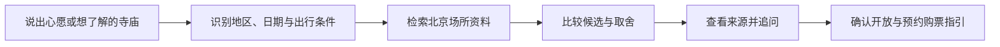

<div align="center">

# 寺庙寻访向导

**带着心愿，找到适合自己的寺庙。**

一个面向北京寺庙寻访的对话式向导：从心愿、参访条件和公开资料出发，帮助你了解、比较，并为出行做好准备。

[项目主页](https://wanchenghhh.github.io/temple-guide-agent/) · [本地运行](#本地运行) · [资料与边界](#资料与边界) · [项目结构](#项目结构)

</div>

## 这个项目解决什么问题

想为家人祈福、求姻缘，或去了解一座寺庙时，人们关心的往往不止是名称：**这里与什么习俗有关？环境如何？带老人是否方便？指定日期能否参访？需要提前预约吗？**

寺庙寻访向导把这些问题放在一次连续对话中。你可以从一个心愿、一座寺庙，或具体的出行条件开始，再逐步比较候选、查看资料和追问细节。

## 可以怎么使用

| 你的问题 | 向导提供的帮助 |
| --- | --- |
| 「周六想为家人求平安，推荐一下。」 | 从北京资料中给出候选；出发地是可选条件，不必先填写地址。 |
| 「带老人，不想爬山，想安静一点。」 | 把体力、环境等条件纳入筛选和比较，并标明无法确认的部分。 |
| 「想先了解雍和宫，再决定去不去。」 | 展示场所、环境、参访条件与可用来源，支持继续问具体问题。 |
| 「这周六开放吗，需要预约吗？」 | 根据已收录的常规开放规则检查日期，提示核实当天公告和预约购票渠道。 |
| 「有人分享过这里的体验吗？」 | 配置公开搜索后，可参考搜索到的分享摘要与原文链接；没有结果时不会补造。 |

网页首页提供一个自由输入框。发送后，桌面端以对话和候选两区展示，手机端可切换对话与候选；选择一处可展开资料，再围绕它继续追问。

## 资料与边界

- **目前聚焦北京。** 仓库内的资料快照包含 30 条场所记录，记录了不同场所的状态、环境、参访条件及来源；数据会随维护调整，并不代表实时开放状态。
- **区分事实与民俗说法。** 殿宇、场所性质等资料与民间祈愿说法分别标注依据；公开分享仅是个人经验，不代表祈愿结果。
- **依据用户条件比较。** 带老人、不爬山、安静和指定日期等条件会进入筛选或取舍说明；现有资料不足时应标为待核实。
- **日期检查不是实时余票查询。** 产品依据已收录的常规规则提示可能的冲突；临时闭馆、放票时间和是否有票，仍需以场所官方渠道为准。产品不代预约或购票。
- **来源有覆盖范围。** 场所资料可查看已有来源；公开分享搜索需要配置并启用博查，搜索可能无结果或不可用。地图、天气属于可选集成，需配置对应服务，未启用时不应视为实时数据。
- **健康与求子相关内容是民俗文化参考**，不替代专业医疗判断。

资料入口：[场所数据](app/agent/domain/temples.json) · [复核清单](docs/temple-review-checklist.md) · [照片来源](static/images/temples/credits.html)

## 一次寻访的过程



遇到资料不足或条件冲突时，向导说明不确定性；不通过编造候选或来源来填补空白。

## 本地运行

需要 Python 3.12。先克隆仓库并安装依赖：

```bash
git clone https://github.com/wanchenghhh/temple-guide-agent.git
cd temple-guide-agent
python3.12 -m venv .venv
source .venv/bin/activate
pip install -r requirements.txt -c requirements.lock
cp .env.example .env
```

编辑 `.env`：

1. 设置 `AUTH_SECRET`。可用 `python -c 'import secrets; print(secrets.token_hex(32))'` 生成随机值。
2. 配置模型服务的 API Key。示例配置默认使用 Kimi，可填写 `KIMI_API_KEY`；也可按 `.env.example` 设置其他 OpenAI 兼容服务。
3. 如需搜索公开分享，配置 `BOCHA_API_KEY` 并设置 `BOCHA_ENABLED=1`；该功能默认关闭。地图和天气同样需要按示例配置启用。

```bash
uvicorn app.main:app --host 127.0.0.1 --port 8787
```

打开 **http://127.0.0.1:8787/**。没有配置模型密钥时可以启动页面，但不能把离线占位回复当成真实模型效果。GitHub Pages 展示 `353e373` 版本的静态界面，运行对话向导需要启动本项目服务。

不要将填写了密钥的 `.env` 提交到仓库。完整配置见 [`.env.example`](.env.example)。

## 项目结构

| 位置 | 作用 |
| --- | --- |
| `app/agent/domain/temples.json` | 北京场所的结构化资料、来源与参访信息 |
| `app/agent/domain/visit_conditions.py` | 同行人、体力、安静偏好和日期可行性规则 |
| `app/agent/temple_context.py` | 识别寻访需求并组织候选资料 |
| `app/agent/temple_card.py` | 组织候选、详情、来源和行前信息 |
| `app/agent/reviews.py` | 按需组织公开搜索结果与原文链接 |
| `static/` | 对话界面、候选资料面板与首页 |
| `site/` | GitHub Pages 项目介绍页 |

技术栈：Python、FastAPI、LangGraph 和原生 HTML / CSS / JavaScript。项目采用 [MIT 许可证](LICENSE)；照片使用各自标注的开放许可。
